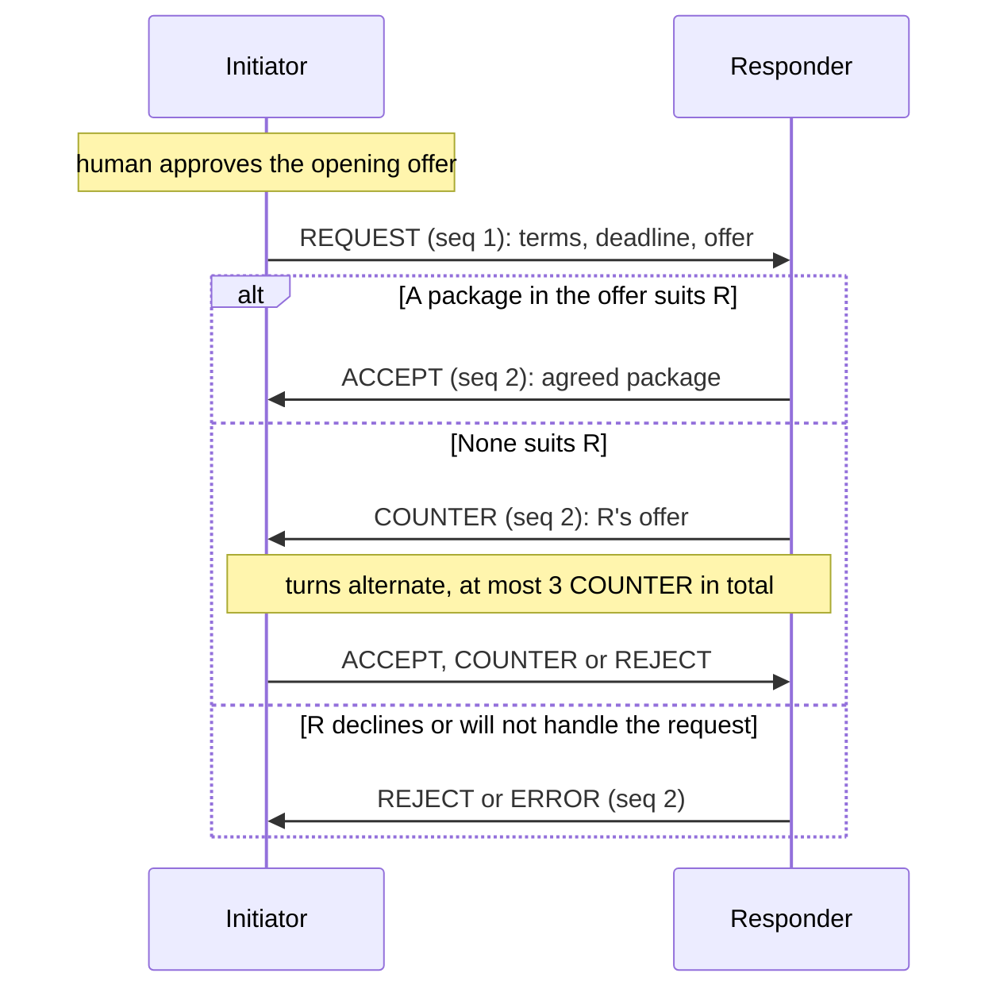

# AUN Protocol 0.4 Specification

AUN lets two personal AI agents agree on a small set of terms on behalf of
their humans: a time, a place, an amount, a yes or no, or any mix of them. The
name comes from *a-un no kokyu*, two people who agree without many words. Each
agent discloses only the options its human approved, and the human keeps the
final say.

0.4 is a breaking change from 0.3: the node ID is longer, `session_version` is
gone, IDs and free text have a character rule, weak keys are refused, late
messages can still arrive, and delivery over HTTP is defined. Nothing of 0.3
carries over: a node makes a new card, and sessions are not migrated. The
reasons are in [docs/design-0.4.md](docs/design-0.4.md). The 0.3 specification
is frozen at tag
[`v0.3.0`](https://github.com/Maaa2005/aun-protocol/tree/v0.3.0) and the 0.2
specification at tag
[`v0.2.0`](https://github.com/Maaa2005/aun-protocol/tree/v0.2.0).

The machine-readable contract is
[schemas/negotiation-message.schema.json](schemas/negotiation-message.schema.json)
for messages and
[schemas/agent-card.schema.json](schemas/agent-card.schema.json) for agent
cards (JSON Schema 2020-12). The schemas check shapes only. The rules that
relate a package to its declaration or to the standing offer are in section
6, and the card checks are in section 11.
[tools/aun_reference.py](tools/aun_reference.py) implements sections 5, 6, 8,
9, 11.2 and the decisions of 11.4 and is the executable reading of this
document.

The key words MUST, MUST NOT, SHOULD and MAY are used as in RFC 2119.

## Overview



When the first offer is acceptable, agreement takes 2 messages.

## 1. Model

- A **node** is one device holding an Ed25519 key pair.
- A **personal agent** is the party a node represents. Its ID says who is
  represented. The node ID binds signatures and transport to the device.
- A **session** is one negotiation between two parties about one `intent`.
  All its messages share `session_id`.
- An **issue** is one term to agree on, for example `place` or `time`. The
  `REQUEST` declares the issues of the session (section 4).
- A **package** has one value for every declared issue. An **offer** is a list
  of packages. Agreement is one package from the other side's last offer
  (section 6).
- A message is one signed JSON object, the **envelope**.

## 2. Identity and envelope

The **node ID** is `agt_` followed by the first 32 lowercase hex characters of
the SHA-256 of the raw 32-byte Ed25519 public key.

All 16 fields are required. No other field is allowed.

| Field | Type | Meaning |
| --- | --- | --- |
| `protocol` | string | Always `"aun/0.4"`. |
| `message_id` | id | Unique per sender node. |
| `session_id` | id | Chosen by the initiator in `REQUEST`. Unique per pair of nodes. |
| `sender_agent_id` | id | Personal agent of the sender. |
| `receiver_agent_id` | id | Personal agent of the receiver. |
| `sender_node_id` | node ID | Device of the sender. Its key verifies `signature`. |
| `receiver_node_id` | node ID | Device of the receiver. |
| `message_type` | string | One of the types in section 3. |
| `intent` | string | A dotted lowercase label naming the kind of agreement, for example `dinner.plan`. At most 64 characters, pattern `^[a-z][a-z0-9_]*(\.[a-z][a-z0-9_]*)*$`. Fixed for the session. |
| `sequence` | integer 1 to 5 | Position in the session, one counter shared by both parties. `REQUEST` is 1. Each message adds exactly 1. |
| `payload` | object | Public context, by message type (section 3). |
| `delta` | object | The offer, the agreed package, or a code (section 3). |
| `nonce` | id | Random value, unique per sender node. |
| `created_at` | date-time | When the sender created the message. Carries `Z` or an offset. |
| `payload_hash` | string | 64 lowercase hex (section 8). |
| `signature` | string | Base64 of the 64-byte Ed25519 signature (section 8). |

An **id** is a string of 1 to 128 ASCII characters, pattern
`^[A-Za-z0-9._~:-]{1,128}$`. Senders SHOULD make `message_id`, `session_id` and
`nonce` at least 128 random bits, for example a UUIDv4, so they never collide
by chance. A node never reuses a `session_id` with the same peer.

**Free text** is `topic`, `unit`, the strings of `options`, the values of
`choice` issues and the card's `display_name`. It MUST NOT hold any code point
of this table, written in hex. The table is fixed by number, so it does not
move with the Unicode version.

| Code points | What they are |
| --- | --- |
| `0000-001F`, `007F-009F` | Control characters, including line breaks |
| `00AD`, `034F`, `061C`, `115F-1160`, `17B4-17B5`, `180E`, `200B`, `200E-200F`, `2060-206F`, `3164`, `FFA0`, `1BCA0-1BCA3`, `1D173-1D17A` | Invisible characters |
| `2028-202E`, `FFF0-FFFB` | Line and paragraph separators, bidirectional embeddings and overrides, specials |
| `FEFF` | Byte order mark |
| `FDD0-FDEF`, and `xFFFE`, `xFFFF` of every plane | Noncharacters |
| `E0000-E0FFF` | Tag characters and supplementary variation selectors, which people do not see and language models read |

ZWNJ and ZWJ (`200C`, `200D`), the variation selectors `FE00-FE0F` and the
Mongolian selectors `180B-180D` and `180F` stay allowed, because ordinary
writing and emoji need them. Refusing the table costs the flag emoji built from
tags, Japanese ideographic variation sequences such as a name's exact glyph, some
old Hangul, and the explicit direction marks of right-to-left writing (the letters
of Arabic and Hebrew pass). A sender removes these before signing. The check is
not expressed in the schema, because patterns outside the ASCII range read
differently with and without the `u` flag of ECMA-262.

The table is no defence on its own. It refuses hidden characters only: letters
that look alike and plain instructions pass it (section 9).

A **date-time** is RFC 3339 with an uppercase `T`, and uppercase `Z` or an offset,
seconds optional, at most 6 fraction digits. It must name a real instant: a calendar date that exists,
hours 00 to 23, minutes and seconds 00 to 59 (no leap second), an offset of
at most 23:59, a written year from 0001 to 9999, and, converted to UTC, a year
from 0001 to 9999. `-00:00` means
UTC.

Lengths count Unicode code points. Strings compare code point by code point,
with no normalization. Only the key order inside JCS (section 8) differs, by
UTF-16 code units as RFC 8785 says. Every pattern in this document and in the schema
matches the whole string with ECMA-262 meaning: `[0-9]` is ASCII only, and `$`
does not match before a trailing newline.

`protocol` is the only version field. 0.3's `session_version` is removed: it had
no meaning, and a receiver had to accept any value. 0.2's
`requires_human_approval` is removed: approval is a local step (section 7), so
a field that announced it carried no checkable meaning.

## 3. Message types

| Type | Sent by | `payload` | `delta` |
| --- | --- | --- | --- |
| `REQUEST` | Initiator, `sequence` 1 | `{"topic", "expires_at", "issues"}` | `{"offer": [package, ...]}` |
| `COUNTER` | Either party | `{"public_reason"}` | `{"offer": [package, ...]}` |
| `ACCEPT` | Either party | `{}` | `{"agreed": package}` |
| `REJECT` | Either party | `{"public_reason"}` | `{"code"}` |
| `ERROR` | Responder, `sequence` 2 only | `{}` | `{"code": "NOT_SUPPORTED"}` |

- `REQUEST.payload.topic`: 1 to 200 characters, shown to the other human.
- `REQUEST.payload.expires_at`: the session deadline (section 5.3).
- `REQUEST.payload.issues`: 1 to 8 issue declarations (section 4).
- `ACCEPT`, `REJECT` and `ERROR` end the session. `REJECT` and `ERROR` codes
  are in section 10.
- `ERROR` answers a valid `REQUEST` that the receiver will not handle, for
  example an intent it does not take. It is allowed only as the answer to
  `REQUEST`, and is otherwise dropped (`INVALID_STATE_TRANSITION`). Later in a
  session the parties already handle the request, and `REJECT` says no.

Illustrative `REQUEST` (computed values shortened):

```json
{
  "protocol": "aun/0.4",
  "message_id": "<id>",
  "session_id": "<id>",
  "sender_agent_id": "agent-a",
  "receiver_agent_id": "agent-b",
  "sender_node_id": "agt_<32 hex>",
  "receiver_node_id": "agt_<32 hex>",
  "message_type": "REQUEST",
  "intent": "dinner.plan",
  "sequence": 1,
  "payload": {
    "topic": "Dinner on Friday",
    "expires_at": "2099-01-02T09:00:00+09:00",
    "issues": [
      {"name": "place", "kind": "choice", "options": ["Sushi", "Pasta", "Ramen"]},
      {"name": "time", "kind": "time", "duration_minutes": 90,
       "window": {"start": "2099-01-01T17:00+09:00", "end": "2099-01-01T22:00+09:00"}},
      {"name": "split_bill", "kind": "flag"}
    ]
  },
  "delta": {
    "offer": [
      {"place": "Sushi", "split_bill": true,
       "time": {"start": "2099-01-01T18:00+09:00", "end": "2099-01-01T19:30+09:00"}},
      {"place": "Pasta", "split_bill": true,
       "time": {"start": "2099-01-01T19:00+09:00", "end": "2099-01-01T20:30+09:00"}}
    ]
  },
  "nonce": "<id>",
  "created_at": "2099-01-01T09:00:00+09:00",
  "payload_hash": "<64 hex>",
  "signature": "<base64>"
}
```

## 4. Issues

Each issue has a `name` matching `^[a-z][a-z0-9_]{0,31}$`, unique in the
request, and one of four kinds. The kind fixes the value shape and how two
values compare. There is no other kind, so a receiver needs no code for a new
kind of agreement: it is a new combination of issues.

| Kind | Declaration | Value | Valid when | Same when |
| --- | --- | --- | --- | --- |
| `choice` | `options` (optional): 1 to 20 distinct strings | string, 1 to 100 characters | in `options`, if declared | the strings are equal |
| `time` | `duration_minutes` 1 to 1440, `window` {start, end} | slot {start, end} | inside the window, length `duration_minutes` | start and end are the same instants |
| `amount` | `unit` (1 to 16 characters), `scale` 0 to 6, `min`, `max`, `step` ≥ 1 | integer | `min ≤ v ≤ max` and `(v - min)` a multiple of `step` | the integers are equal |
| `flag` | nothing | `true` or `false` | always | the booleans are equal |

Rules for the declaration:

- `choice` without `options` is open: an offer MAY bring new values, for
  example a new place.
- `time`: slot and window times are at minute precision (`HH:MM` or
  `HH:MM:00`) with an offset. The window start is before its end, the window is
  at most 31 days, and `duration_minutes` fits in it.
- `amount`: an integer in the smallest unit. The real value is
  `v × 10^-scale` in `unit`. `min ≤ max`, and `max - min` is at most
  2^53 - 1, so `v - min` stays exact in every language. All integers are
  within ±(2^53 - 1). There is no floating point anywhere in 0.4.
- The declaration is fixed for the session. Names, kinds, options, units and
  limits never change.

A `REQUEST` with an invalid declaration opens no session.

## 5. Session state

A node records, per session: both parties (agent ID and node ID), `intent`, the
`REQUEST`'s `created_at`, the deadline, the declaration, the **standing offer** (the
last offer sent), the last sender, the last `sequence`, the number of
`COUNTER` messages, and a status: `open`, `agreed`, `rejected`,
`not_supported` or `expired`.

### 5.1 Opening

A `REQUEST` opens the session. The sender becomes the initiator, the receiver
the responder. A `REQUEST` whose declaration is valid but whose offer is not
opens no session either.

A node knows a session by the other party's node ID together with
`session_id`. The same `session_id` from another node is another session, so
one peer cannot block or guess its way into a session of another. A second
`REQUEST` for a session already known from the same node is dropped
(`MESSAGE_REPLAYED`).

A `REQUEST` is checked in this order: whether the session is known, the deadline
rule of section 5.3, arrival on time, the declaration, the offer.

### 5.2 Turns

- Every later message comes from one party of the session and goes to the
  other. Else `SESSION_BINDING_MISMATCH`. `intent` equals the recorded value.
  Else `SESSION_BINDING_MISMATCH`.
- Senders strictly alternate: only the party that did not send the previous
  message may send the next one. There is no withdrawal while the other side
  is answering, because a withdrawal racing an `ACCEPT` would leave the two
  sides with different results.
- `sequence` is the last recorded value plus 1.
- At most 3 `COUNTER` per session, counted over both parties. So a session has
  at most 5 messages.
- After `ACCEPT`, `REJECT` or `ERROR` the session is closed. Any later message
  is dropped (`INVALID_STATE_TRANSITION`).

A message that breaks a turn rule is dropped with `INVALID_STATE_TRANSITION`.
A message for an unknown session that is not a `REQUEST` is dropped the same
way. That includes a message from a node that is not a party: for that node
the session does not exist.

A later message is checked in this order, and the first failure gives the code:

1. `intent` and the parties (`SESSION_BINDING_MISMATCH`).
2. A `sequence` already recorded (`MESSAGE_REPLAYED`, section 9 step 8).
3. The session is closed (`INVALID_STATE_TRANSITION`), or arrival is too late
   (`SESSION_EXPIRED`, section 5.3).
4. `sequence` and turn (`INVALID_STATE_TRANSITION`).
5. `created_at` (section 5.3).
6. The rules of the message type: the limit of 3 `COUNTER`, `ERROR` only as the
   answer to `REQUEST`, and section 6.

### 5.3 Deadline

- `REQUEST.payload.expires_at` fixes one deadline. It MUST be after the
  `REQUEST`'s `created_at` and at most 7 days later (else
  `INVALID_NEGOTIATION_PAYLOAD`). It cannot be extended.
- A later message is on time when its signed `created_at` is not after
  `expires_at` (else `SESSION_EXPIRED`) and not more than 300 seconds before
  the `REQUEST`'s `created_at` (else `MESSAGE_EXPIRED`). `created_at` is the
  sender's own claim. It does not prove when the message was really made.
- A message arrives on time when the clock of the receiving node, at the moment it
  runs these checks, is at most 300 seconds after `expires_at` (else
  `SESSION_EXPIRED`). This holds for a `REQUEST` too, so a message that a relay kept
  for hours still counts. The time an endpoint took it does not count, and a node
  that fetches from its endpoint too late drops the message.
- A session with no closing message becomes `expired` 300 seconds after
  `expires_at`. That is the clock passing, not an effect of a dropped message.
- A sender MAY resend any message it sent, as the identical bytes, until the
  endpoint takes it (section 11.4) or 300 seconds after `expires_at`, whichever
  comes first. It never signs the same step again with other content, so one
  `ACCEPT` stays one `ACCEPT`.
- The sender of an `ACCEPT` MUST keep two facts apart for its human: its own
  decision to accept, and the delivery, which is "not deposited" or "deposited,
  the other side's acceptance is not known". A deposit does not prove that the
  other side received or accepted it, and neither the deadline nor any other
  time passing turns it into a certain outcome. The protocol does not hide this
  case.

## 6. Packages, offers and agreement

- A **package** is an object with exactly one valid value (section 4) for
  every declared issue, and no other key.
- An **offer** is `delta.offer`: 1 to 5 packages, no two the same by the
  comparison of section 4 (the same slot written with another offset is a
  repeat). The order of packages carries no meaning. Offering
  whole packages keeps combinations intact: if a human approved "Sushi at
  18:00" and "Pasta at 19:00", the peer cannot pick "Sushi at 19:00".
- An `ACCEPT` carries one package in `delta.agreed`. It MUST be the same,
  issue by issue, as one package of the standing offer, which is always the
  receiver's own last offer. Times compare as instants, so the same slot
  written with another offset is the same value.
- Whether a package suits the accepting side is that side's local decision.
  The wire check only proves the package was offered.

A message that breaks a rule of this section, or of section 4, is dropped with
`INVALID_NEGOTIATION_PAYLOAD`. The session stays as it was, still waiting for
a valid message from the same party.

Disclosure is bounded: at most 5 packages per offer and at most 4 offers per
session, 20 packages in all. Limits, preferences and reasons are never sent
(section 10).

## 7. Approval

Every package in an offer is binding once sent: the peer may accept it, and
then the session is agreed.

- Before a node sends `REQUEST`, `COUNTER` or `ACCEPT`, every package in it
  MUST be approved by its human, or covered by a delegation the human set up
  whose scope includes that package.
- `REJECT` with `HUMAN_REJECTED` or `APPROVAL_EXPIRED` reports the human's
  decision, or the lack of one.
- Not offering the same slot or item in two open sessions at once is a local
  duty. It cannot be seen on the wire.

Approval is a local step, not a message. A receiver cannot check it, so the
reference checker does not.

## 8. Signing

The signature covers every field except `signature`. Keys and signatures are
Ed25519 (RFC 8032). A point written in 32 bytes is **weak** when, read as a
little-endian integer with the top bit cleared, its value y is at least
2^255 - 19, or is one of these five values given here as bytes in hex:

- `0000000000000000000000000000000000000000000000000000000000000000`
- `0100000000000000000000000000000000000000000000000000000000000000`
- `ecffffffffffffffffffffffffffffffffffffffffffffffffffffffffffff7f`
- `26e8958fc2b227b045c3f489f2ef98f0d5dfac05d3c63339b13802886d53fc05`
- `c7176a703d4dd84fba3c0b760d10670f2a2053fa2c39ccc64ec7fd7792ac037a`

These are the points of small order, with either sign bit, and the spellings of
y that are not canonical. Libraries answer differently, so this document decides.
Anyone can forge signatures for a small-order public key, with no private
key, so such a key would also let its holder deny what it signed.

A signature verifies when its R (the first 32 bytes) is not weak, its S (the
last 32 bytes, as a little-endian integer) is below the group order
2^252 + 27742317777372353535851937790883648493, and the verification of RFC 8032
succeeds with the key. Refusing a weak R is about interoperability, not forgery:
only the key's holder can make such a signature, and libraries otherwise answer
differently. Keys with a small-order component mixed in are not refused, because
a check needs a costly group operation. The holder of such a key can still make
signatures that some libraries accept and others do not.

1. `payload_hash` is the lowercase hex SHA-256 of the UTF-8 bytes of the JCS
   (RFC 8785) serialization of `{"payload": <payload>, "delta": <delta>}`.
2. Build the envelope with `payload_hash` and without `signature`.
3. Serialize it with JCS and sign the bytes with the sender node's Ed25519
   private key.
4. Set `signature` to the standard Base64, with padding, of the 64-byte
   signature.

Base64 here, and for keys in section 11, is the one canonical form of RFC 4648
section 4: standard alphabet, padding, no line breaks, and unused bits zero. A
signature is therefore 88 characters whose last data character is one of `A`,
`Q`, `g` or `w`. A receiver refuses every other spelling of the same bytes, so a
message has one signed form.

A receiver verifies with the key it holds for `sender_node_id` (section 11).
It never takes the key from the message.

An implementation MUST reproduce the vectors in
[test-vectors/jcs-v0.2.json](test-vectors/jcs-v0.2.json) before it exchanges
signed messages. The canonicalization has not changed since 0.2.

## 9. Receiver checks

Peer input is untrusted. A receiver runs these checks in order. A failed check
drops the message, changes nothing and gets no reply. Dropping is a MUST.
Reporting the listed code locally SHOULD match this section; the vectors of
section 14 check both.

1. **Size.** At most 16384 bytes, checked before parsing. Else
   `MESSAGE_TOO_LARGE`. A sender MUST check the same limit. The total limit
   wins over the per-field limits.
2. **Strict JSON.** One JSON object in valid UTF-8 with no byte order mark,
   following I-JSON (RFC 7493): nesting at most 8 levels of objects and arrays
   counting the envelope as level 1, no duplicate keys, no lone surrogate (written or
   escaped), and integers only, within ±(2^53 - 1). So no fraction or exponent
   (no `3000.0`, no `1E0`), no `NaN` or infinities. `-0` reads as the integer 0.
   Else
   `MESSAGE_SCHEMA_INVALID`.
3. **Schema.** The envelope matches the 0.4 schema, every date-time in it is
   valid and every free text holds no refused code point (section 2). Every string
   value of a package counts as free text here, before its issue is looked up.
   Else `MESSAGE_SCHEMA_INVALID`.
4. **Peer and address.** `sender_node_id` is a trusted peer (else
   `PEER_NOT_TRUSTED`), whose registered personal agent is `sender_agent_id`
   (else `AGENT_IDENTITY_MISMATCH`). `receiver_node_id` and
   `receiver_agent_id` are this node and its agent (else
   `SESSION_BINDING_MISMATCH`).
5. **Signature.** `payload_hash` matches and the signature verifies. Else
   `MESSAGE_SIGNATURE_INVALID`.
6. **Clock ahead.** `created_at` is at most 300 seconds after the receiver's
   clock. Else `MESSAGE_EXPIRED`. There is no limit in the past here: section
   5.3 limits a late message, and step 7 and step 8 stop a copy.
7. **Duplicates and replay.** A message whose `message_id` is known from the
   same sender node and whose bytes, as JCS, are identical to the recorded one
   is a **duplicate**: it is ignored without error, also after the session
   closed, so this comes before any check of the session. A different message with
   a `message_id` known from that node, or a nonce that node already used, is
   dropped (`MESSAGE_REPLAYED`).
8. **State and payload.** Sections 5 and 6: the session, the turn, the
   deadline, the declaration and the packages, in the order of sections 5.1 and
   5.2. A message for a `sequence` already recorded is dropped (`MESSAGE_REPLAYED`).

A node runs steps 7 and 8 and records their result as one atomic step for a
session, so two copies arriving together give one `accepted` and one duplicate.
It keeps sessions, message IDs and nonces durably, per sender node, until its clock
is past 300 seconds after the session deadline, or longer. After that a copy of a `REQUEST`
is dropped by its deadline (section 5.3) and any other copy as a message for an
unknown session. A node that loses these records can accept a copy of a `REQUEST`
again, up to about 7 days later. 0.4 gives no protection in that case. Such a
node SHOULD take no `REQUEST` until 7 days and 600 seconds after the loss.

A dropped message records nothing, so its message ID and nonce stay unused. A
sender runs steps 1 to 3, 7 and 8 on its own message before sending it, by its
own clock. For step 7 that means it never reuses one of its own message IDs or
nonces.

### Free text is data

Free text (section 2), issue names and `intent` come from the peer.
A node MUST NOT follow them as instructions. They MUST NOT change approval
settings, reach secrets or start external actions. A node SHOULD show its
human the peer's text apart from what it verified itself: who sent it, which
package, and whether it was approved.

`display_name` is not proof of who a peer is. Letters that look alike pass
section 2 (RFC 8264 section 12.5). A node SHOULD show the node ID beside the name
when two stored cards have the same name, and when a peer's name changes.

## 10. Codes and disclosure

`REJECT` codes in `delta.code`:

| Code | Meaning |
| --- | --- |
| `NO_AGREEMENT` | No acceptable package and no counter left. |
| `OUTSIDE_LIMIT` | The offers are beyond what this side will ever accept. The limit is not sent. |
| `HUMAN_REJECTED` | The human declined. |
| `APPROVAL_EXPIRED` | The human did not decide in time. |

`ERROR` has one code, `NOT_SUPPORTED`.

`payload.public_reason` in `COUNTER` and `REJECT` is one of three coarse
categories:

| Value | Used when |
| --- | --- |
| `no_common_option` | No package of the standing offer suits this side. |
| `constraint_violation` | The offer breaks a constraint of this side. The constraint is not sent. |
| `policy_declined` | The delegation, approval policy or human declined. |

A message carries only what the peer needs to continue. A node MUST NOT send
limits, reservation values, preference weights, calendar content (titles of
busy entries, why a time was excluded) or internal reason codes.

Receiver-side outcomes of section 9, which are never sent:
`MESSAGE_TOO_LARGE`, `MESSAGE_SCHEMA_INVALID`, `PEER_NOT_TRUSTED`,
`AGENT_IDENTITY_MISMATCH`, `MESSAGE_SIGNATURE_INVALID`, `MESSAGE_EXPIRED`,
`MESSAGE_REPLAYED`, `SESSION_BINDING_MISMATCH`, `INVALID_STATE_TRANSITION`,
`SESSION_EXPIRED`, `INVALID_NEGOTIATION_PAYLOAD`. The card outcomes are in
section 11.2. An HTTP answer does not carry them either (section 11.4).

## 11. Trust, agent card and transport

Each node describes itself with an **agent card**: a small JSON object signed
by the node key. Two nodes trust each other out of band: each takes the
other's whole card in person, for example by scanning it as a QR code. The
signature proves only that the card's maker holds the key. It does not say who
the human is. The in-person step does.

### 11.1 Fields

All nine fields are required. No other field is allowed. The shapes are in
[schemas/agent-card.schema.json](schemas/agent-card.schema.json).

| Field | Type | Meaning |
| --- | --- | --- |
| `version` | string | Always `"aun-card/2"`. |
| `node_id` | node ID | Derived from `public_key` (section 2). |
| `agent_id` | id | The personal agent represented. |
| `public_key` | string | Base64 of the raw 32-byte Ed25519 key, in the canonical form of section 8: 44 characters. |
| `display_name` | string of 1 to 100 code points | Name shown to humans. Free text (sections 2 and 9). |
| `protocol_versions` | array of 1 to 8 distinct strings of 1 to 32 printable ASCII characters other than space | Includes `"aun/0.4"`. Other entries are ignored. |
| `relay_endpoint` | string | Where the node receives messages: `https://` followed by 1 to 248 printable ASCII characters other than space. A card is not refused for an endpoint that a sender will not use (section 11.4). |
| `issued_at` | date-time | When the node made this card (section 2). |
| `signature` | string | Base64 of the 64-byte Ed25519 signature by the card's own key over the JCS of the card without `signature` (section 8). |

All four issue kinds are mandatory, so a card does not list them. Accepting
the format is not accepting every agreement: a node MAY still answer
`NOT_SUPPORTED`.

### 11.2 Card checks

A card is peer input, like a message. A node runs these checks in order. A
failed check refuses the card and changes nothing.

1. **Size.** At most 2048 bytes, checked before parsing, so a card fits in
   one QR code. Else `CARD_TOO_LARGE`. The total limit wins over the
   per-field limits.
2. **Strict JSON.** As section 9 step 2. Else `CARD_SCHEMA_INVALID`.
3. **Schema.** The card matches the card schema, `issued_at` is a real instant
   and `display_name` holds no refused code point (section 2). Else
   `CARD_SCHEMA_INVALID`.
4. **Identity.** `node_id` is derived from `public_key`. Else
   `CARD_IDENTITY_MISMATCH`.
5. **Key.** `public_key` is not weak (section 8). Else `CARD_KEY_WEAK`. This
   comes before the signature, because anyone can make a signature that passes
   for such a key.
6. **Signature.** `signature` verifies with `public_key` (section 8). Else
   `CARD_SIGNATURE_INVALID`.
7. **Version.** `protocol_versions` includes `"aun/0.4"`. Else
   `CARD_VERSION_UNSUPPORTED`.
8. **Clock.** `issued_at` is at most 300 seconds after the receiver's clock.
   Else `CARD_NOT_YET_VALID`. Without this limit, one card dated far ahead
   would block every later update (step 9). There is no lower limit: an old
   card is still valid.
9. **Stored card.** Look up the stored card by `node_id`.
   - None is stored: the card is stored only when it came through the
     in-person step. Else `CARD_PEER_NOT_TRUSTED`.
   - One is stored: `public_key` must be byte for byte the stored key and
     `agent_id` the stored agent (else `CARD_IDENTITY_MISMATCH`), and
     `issued_at`, compared as an instant, must be strictly later than the
     stored one (else `CARD_STALE`). So the same card sent again, or written
     with another offset for the same instant, is `CARD_STALE`. The new card
     then replaces the stored one.
   - A peer whose whole key was registered out of band without a card counts
     as stored with no `issued_at`. Its first card is stored from any channel
     when `public_key` and `agent_id` match (else `CARD_IDENTITY_MISMATCH`). A
     node MUST NOT register a weak key this way.

A node compares and replaces the stored card in one step and keeps it
durably. Two updates arriving together therefore cannot leave the older one
stored, and a restart does not bring an older card back.

Receiver-side card outcomes, which are never sent, also not in an `ERROR`:
`CARD_TOO_LARGE`, `CARD_SCHEMA_INVALID`, `CARD_IDENTITY_MISMATCH`,
`CARD_KEY_WEAK`, `CARD_SIGNATURE_INVALID`, `CARD_VERSION_UNSUPPORTED`, `CARD_NOT_YET_VALID`,
`CARD_PEER_NOT_TRUSTED`, `CARD_STALE`.

A node runs steps 1 to 8 on its own card before handing it out. Each new card
it makes has an `issued_at` strictly later than all its earlier cards, so the
node keeps the last one durably instead of trusting its clock alone.

### 11.3 Updates, keys and endpoints

A later card replaces `display_name`, `protocol_versions` and
`relay_endpoint`. Sessions, message IDs and nonces already recorded are not
affected. Because the key is already trusted, an update may come by any
channel, for example from the relay. A first card counts only after the
in-person step.

The node ID has 128 bits. Finding a second key for somebody else's node ID takes
about 2^128 attempts. Making two keys of one's own with the same node ID takes
about 2^64, which is within reach of a large attacker but only confuses the
attacker's own identity. The in-person step still covers the whole key, for
example by scanning the whole card. Reading out the node ID alone is not enough.
Messages are verified with the full stored key (section 8), and step 9 keeps
the stored key, so a colliding key is refused rather than taking its place.

A new key is a new peer. A node that loses or replaces its key gets a new
card, and its peers trust it again in person. Nothing carries over from the
old key, neither the card nor the sessions. Removing the old card is a local
step of the human. 0.4 has no revocation and no expiry.

`relay_endpoint` comes from the peer. A node uses it only to deliver AUN
messages and cards to that peer (section 11.4), and sends no credential there.
It SHOULD show its human when a peer's endpoint changes.

Limits (informative): a receiver whose clock runs fast can accept a card dated
ahead of the sender's clock. A relay can withhold a newer card. A node
restored from an old backup can accept an older card again. A stolen key can
sign a valid update. 0.4 does not prevent these.

### 11.4 Delivery

Two implementations meet at one place: a sender hands a message to the
receiver's `relay_endpoint`. How the endpoint passes it on to the receiver's node
is that side's own matter and is not specified here.

**The request.** `POST` to `relay_endpoint`, exactly as the card writes it, over
TLS with the certificate verified. The body is the bytes of the message, without
compression and with a `Content-Length`. `Content-Type` is `application/aun+json` for a message and
`application/aun-card+json` for a card. There is no other authentication: a
signature inside the body already says who sent it, and the node checks that
(section 9).

**The endpoint.** It answers:

| Status | Meaning |
| --- | --- |
| `202` | The endpoint took the body. Nothing more: the other side may not have read or accepted it. |
| `400` | Not exactly one `Content-Length` of digits, or a `Transfer-Encoding` or `Content-Encoding`. |
| `405`, `415` | Not a `POST`, or another media type. |
| `413` | Over 16384 bytes for a message or 2048 bytes for a card. |
| `429`, `5xx` | Not taken now. `429` SHOULD carry `Retry-After`. |

An endpoint MUST NOT make its answer depend on the checks of sections 9 or 11.2,
so a message that will be dropped gets the same `202`. It MAY limit the rate by
its own policy, which does not look at those checks or at who is trusted either.

**The sender.**

- Any `2xx` is the deposit of section 5.3.
- `408`, `429`, `5xx` or a failed connection, which includes a certificate that
  fails: send the identical bytes again after a pause, at least as long as
  `Retry-After` asks in either of its forms, and stop 300 seconds after `expires_at`.
  A pause asked for beyond that ends the sending. A card update stops after a limited
  number of attempts of the sender's choice.
- The status is enough, so a sender does not read the body of an answer, and it
  limits the time of one attempt, so an endpoint cannot hold it past the limit.
- Any other status gives up. A redirect is not followed.
- It MUST NOT use an endpoint that does not parse by RFC 3986 as an `https` URL
  with a host and a port from 1 to 65535 if one is written, or that has user
  information, a `#` or a backslash.
- It MUST check every address it connects to, after resolving the name and on the
  connection it really uses. A second resolution MUST NOT be able to move that
  connection. Only a node's own configuration can allow other addresses than
  these, for example for tests:

| Family | A sender connects only to |
| --- | --- |
| IPv4, also as `::ffff:0:0/96` or `64:ff9b::/96` | Anything but `0.0.0.0/8`, `10.0.0.0/8`, `100.64.0.0/10`, `127.0.0.0/8`, `169.254.0.0/16`, `172.16.0.0/12`, `192.0.0.0/24`, `192.0.2.0/24`, `192.88.99.0/24`, `192.168.0.0/16`, `198.18.0.0/15`, `198.51.100.0/24`, `203.0.113.0/24`, `224.0.0.0/4`, `240.0.0.0/4` |
| Other IPv6 | `2000::/3`, but not `2001::/23`, `2001:db8::/32`, `2002::/16` or `3fff::/20` |

The table is fixed here because the registries behind it (RFC 6890) grow and
libraries answer differently. A longer list of refusals is allowed.

Nothing tells a sender that a body was lost after a `202`. A sender and an endpoint
are in [tools/aun_http.py](tools/aun_http.py).

Probing a peer's limits with repeated sessions is a local policy matter. This
specification does not claim to prevent it.

## 12. Profiles

A profile is a conventional `intent` with a fixed issue list. It needs no
receiver code.

- `meeting.schedule`: one `time` issue named `slot`. 0.2's `date_range`,
  `preferred_time_ranges` and `timezone` are not sent; the window and the
  offsets carry the same information.
- `cost.split`: one `amount` issue named `share`, with `min` 0 and `max` the
  total. The `topic` names the total for the humans.

Other agreements, such as a dinner plan, a favour or a shared gift, are just
other issue lists. The examples show three.

## 13. Versioning

- This document specifies `aun/0.4`. Every conforming message has
  `"protocol": "aun/0.4"`. The card lists `aun/0.4`.
- 0.3, 0.2 and 0.1 messages are not valid 0.4 messages. There is no automatic
  fallback to an older version.

## 14. Examples and conformance

This section is informative.

- [examples/](examples/) has seven signed sessions: `meeting-schedule`
  (agreed in 2 messages), `meeting-schedule-no-agreement` (three counters,
  then `REJECT`), `cost-split`, `cost-split-rejected`, `dinner-plan` (three
  issues), `favor-ask` and `gift-pick` (an open choice). The keys in
  [examples/keys.json](examples/keys.json) come from public strings. They are
  for tests only and MUST NOT be used for real messages.
- [tools/make_examples.py](tools/make_examples.py) builds every example by
  sending it through two reference nodes, so every example follows sections 5
  and 6. It regenerates the files byte for byte.
- `python tools/aun_reference.py check-session <dir> --keys examples/keys.json`
  replays one session through the receiver checks.
- [test-vectors/receiver-v0.4.json](test-vectors/receiver-v0.4.json) holds
  receiver cases for any language: sessions, turn and deadline rules, replay,
  the limits of section 9, the order of its checks, and hostile input
  (malformed JSON, dates and numbers). Each case starts a fresh node B that
  trusts A and C but not D, and lists steps in order. A `receive` step gives
  the message bytes in Base64, the receiver's clock `now`, and `expect`:
  `accepted`, `duplicate` or the code of the drop. A `send` step is a message
  B itself sends, after the sender checks of section 9. After the last step,
  `final` is the status of B's session `s1` with A at the `now` of that step,
  or `null` if B has none.
  A drop changes nothing. An implementation passes when every step gives
  `expect` and every case ends with `final`. A receiver that drops the
  message but reports another code still meets the MUST of section 9.
- [tools/make_vectors.py](tools/make_vectors.py) builds that file byte for
  byte, and `python tools/make_vectors.py --check` replays it through the
  reference node.
- [examples/cards/](examples/cards/) has the cards of the two example nodes,
  and `python tools/aun_reference.py verify-card <file>` runs card checks 1
  to 8 of section 11.2 on one card.
- [test-vectors/card-v2.json](test-vectors/card-v2.json) holds card cases.
  Each case starts a fresh node B that has stored no card, and lists steps in
  order. A step gives the card bytes in Base64, the receiver's clock `now`,
  `in_person` (whether the card came through the in-person step) and
  `expect`: `trusted` for a first card, `updated` for a later card, or the
  code of the refusal. After the last step, `final` is the `issued_at` of the
  card B stores for A, as written in that card, or `null` if B stores none.
  A refusal changes nothing.
- [tools/make_card_vectors.py](tools/make_card_vectors.py) builds that file
  byte for byte, and `python tools/make_card_vectors.py --check` replays it
  through the reference node.
- `pytest -q` runs [tests/test_conformance.py](tests/test_conformance.py): the
  JCS vectors, every example, the receiver vectors, the card vectors, and more
  dropped cases of sections 4 to 9.

- [tests/test_http.py](tests/test_http.py) runs section 11.4 over real TLS
  connections on one machine, through [tools/aun_http.py](tools/aun_http.py).

Not covered by tests: approval (section 7), free text handling (section 9),
double booking across sessions (section 7), the unknown outcome of an
unconfirmed `ACCEPT` (section 5.3), the in-person step, durable storage, and
delivery across a real network. These are local duties a receiver cannot observe.

## 15. Security considerations

This section states what 0.4 gives and what it does not. It adds no rule.

What holds:

- **Authenticity and integrity.** Every message carries an Ed25519 signature
  (RFC 8032) over the JCS form (RFC 8785) of every field but `signature`
  (section 8). A receiver that holds the sender's key (section 11) can tell
  that the message came from that key and was not changed. A card is signed
  the same way by its own key (section 11.2).
- **Replay and ordering.** Duplicate, session, turn and deadline checks (sections
  5 and 9) stop a copy of a valid message from being used again or out of turn,
  as long as the node keeps its records.
- **Trust comes from the in-person step.** A signature proves only that the
  signer holds the key. Who the human behind the key is comes from the
  in-person exchange of the card (section 11).

What does not hold:

- **No confidentiality.** Messages are signed, not encrypted. The endpoint and
  every other hop that carries a message can read `topic`, the issue
  declarations, every offered package, counter-offers and `public_reason`, and
  can see who talks to whom, when, and how much. TLS (section 11.4) protects only
  the connection to the endpoint.
- **"Disclose only approved options" is a rule about what the agent chooses to
  send** (sections 7 and 10). It is not a property of the encoding. Anything
  that an agent sends is readable by the endpoint and by the peer.
- **No delivery guarantee.** An endpoint or network can drop, delay or withhold a
  message (sections 5.3, 11.3 and 11.4). A `202` is a deposit, not a receipt.

### Known limitations (non-normative)

This list is informative. It does not change any requirement above, and
nothing here is a promise of a design.

- **Lost records.** A node that loses its sessions and message IDs can accept a
  copy of a `REQUEST` for about 7 days (section 9).
- **Mixed-order keys.** A key with a small-order component mixed in is not refused.
  Its holder can make signatures that some libraries accept and others do not
  (section 8).
- **Look-alike text.** Section 2 refuses hidden characters only. Letters that look
  alike and plain instructions in free text pass it (section 9).
- **Decimal numbers in the JCS vectors.** `test-vectors/jcs-v0.2.json` contains
  numbers that are not integers (`4.5`, `0.000001`) although 0.4 allows integers
  only (section 9, step 2). An implementation that supports only integers cannot
  reproduce those cases.

## 16. References

Normative:

- RFC 2119, Key words for use in RFCs to Indicate Requirement Levels.
- RFC 3339, Date and Time on the Internet: Timestamps (section 2).
- RFC 3986, Uniform Resource Identifier (URI): Generic Syntax (section 11.4).
- RFC 4648, The Base16, Base32, and Base64 Data Encodings, section 4
  (section 8).
- RFC 7493, The I-JSON Message Format (section 9, step 2).
- RFC 8032, Edwards-Curve Digital Signature Algorithm (EdDSA), for Ed25519
  (sections 2, 8 and 11).
- RFC 8785, JSON Canonicalization Scheme (JCS) (section 8).
- RFC 9110, HTTP Semantics (section 11.4).
- ECMA-262, ECMAScript Language Specification, for the meaning of patterns
  (section 2).
- JSON Schema 2020-12, for the schemas.

Informative:

- RFC 6890, Special-Purpose IP Address Registries (the table of section 11.4).
- RFC 8264, PRECIS Framework (section 9).
