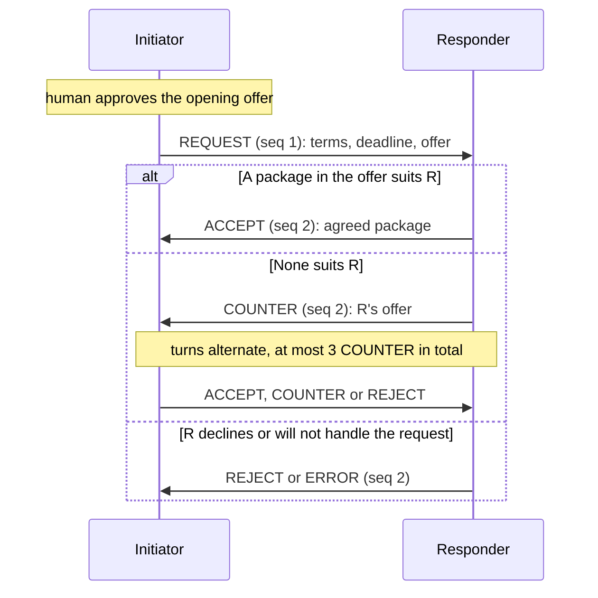

# AUN Protocol 0.3 Specification

AUN lets two personal AI agents agree on a small set of terms on behalf of
their humans: a time, a place, an amount, a yes or no, or any mix of them. The
name comes from *a-un no kokyu*, two people who agree without many words. Each
agent discloses only the options its human approved, and the human keeps the
final say.

0.3 is a breaking change from 0.2. 0.2 negotiated only meetings and cost
shares, each with its own payload. 0.3 has one generic format: the request
declares the terms, and every later message offers or accepts complete
packages of values. The 0.2 specification is frozen at tag
[`v0.2.0`](https://github.com/Maaa2005/aun-protocol/tree/v0.2.0).

The machine-readable contract is
[schemas/negotiation-message.schema.json](schemas/negotiation-message.schema.json)
(JSON Schema 2020-12). The schema checks shapes only. The rules that relate a
package to its declaration or to the standing offer are in section 6.
[tools/aun_reference.py](tools/aun_reference.py) implements sections 5, 6, 8
and 9 and is the executable reading of this document.

The key words MUST, MUST NOT, SHOULD and MAY are used as in RFC 2119.

## Overview



When the first offer is acceptable, agreement takes 2 messages.

## 1. Model

- A **node** is one device holding an Ed25519 key pair.
- A **personal agent** is the party a node represents. Its ID says who is
  represented. The node ID binds signatures and transport to the device.
- A **session** is one negotiation between two parties about one `intent`.
  All its messages share `session_id`.
- An **issue** is one term to agree on, for example `place` or `time`. The
  `REQUEST` declares the issues of the session (section 4).
- A **package** has one value for every declared issue. An **offer** is a list
  of packages. Agreement is one package from the other side's last offer
  (section 6).
- A message is one signed JSON object, the **envelope**.

## 2. Identity and envelope

The **node ID** is `agt_` followed by the first 16 lowercase hex characters of
the SHA-256 of the raw 32-byte Ed25519 public key.

All 17 fields are required. No other field is allowed.

| Field | Type | Meaning |
| --- | --- | --- |
| `protocol` | string | Always `"aun/0.3"`. |
| `message_id` | id | Unique per sender node. |
| `session_id` | id | Chosen by the initiator in `REQUEST`. Unique per pair of nodes. |
| `sender_agent_id` | id | Personal agent of the sender. |
| `receiver_agent_id` | id | Personal agent of the receiver. |
| `sender_node_id` | node ID | Device of the sender. Its key verifies `signature`. |
| `receiver_node_id` | node ID | Device of the receiver. |
| `message_type` | string | One of the types in section 3. |
| `intent` | string | A dotted lowercase label naming the kind of agreement, for example `dinner.plan`. At most 64 characters, pattern `^[a-z][a-z0-9_]*(\.[a-z][a-z0-9_]*)*$`. Fixed for the session. |
| `session_version` | integer 1 to 1000 | Fixed for the session. Senders use `1`. A receiver accepts any value in range and holds the session to it. |
| `sequence` | integer 1 to 5 | Position in the session, one counter shared by both parties. `REQUEST` is 1. Each message adds exactly 1. |
| `payload` | object | Public context, by message type (section 3). |
| `delta` | object | The offer, the agreed package, or a code (section 3). |
| `nonce` | id | Random value, unique per sender node. |
| `created_at` | date-time | When the sender created the message. Carries `Z` or an offset. |
| `payload_hash` | string | 64 lowercase hex (section 8). |
| `signature` | string | Base64 of the 64-byte Ed25519 signature (section 8). |

An **id** is a string of 1 to 128 characters. Senders SHOULD make
`message_id`, `session_id` and `nonce` at least 128 random bits, for example a
UUIDv4, so they never collide by chance.

A **date-time** is RFC 3339 with `Z` or an offset, seconds optional, at most 6
fraction digits. It must name a real instant: a calendar date that exists,
hours 00 to 23, minutes and seconds 00 to 59 (no leap second), an offset of
at most 23:59, and, converted to UTC, a year from 0001 to 9999. `-00:00` means
UTC.

Lengths count Unicode code points. Strings compare code point by code point,
with no normalization. Every pattern in this document and in the schema
matches the whole string with ECMA-262 meaning: `[0-9]` is ASCII only, and `$`
does not match before a trailing newline.

0.2's `requires_human_approval` is removed. Approval is a local step
(section 7), so a field that announced it carried no checkable meaning.

## 3. Message types

| Type | Sent by | `payload` | `delta` |
| --- | --- | --- | --- |
| `REQUEST` | Initiator, `sequence` 1 | `{"topic", "expires_at", "issues"}` | `{"offer": [package, ...]}` |
| `COUNTER` | Either party | `{"public_reason"}` | `{"offer": [package, ...]}` |
| `ACCEPT` | Either party | `{}` | `{"agreed": package}` |
| `REJECT` | Either party | `{"public_reason"}` | `{"code"}` |
| `ERROR` | Responder, `sequence` 2 only | `{}` | `{"code": "NOT_SUPPORTED"}` |

- `REQUEST.payload.topic`: 1 to 200 characters, shown to the other human.
- `REQUEST.payload.expires_at`: the session deadline (section 5.3).
- `REQUEST.payload.issues`: 1 to 8 issue declarations (section 4).
- `ACCEPT`, `REJECT` and `ERROR` end the session. `REJECT` and `ERROR` codes
  are in section 10.
- `ERROR` answers a valid `REQUEST` that the receiver will not handle, for
  example an intent it does not take. It is allowed only as the answer to
  `REQUEST`. Later in a session the parties already handle the request, and
  `REJECT` says no.

Illustrative `REQUEST` (computed values shortened):

```json
{
  "protocol": "aun/0.3",
  "message_id": "<id>",
  "session_id": "<id>",
  "sender_agent_id": "agent-a",
  "receiver_agent_id": "agent-b",
  "sender_node_id": "agt_<16 hex>",
  "receiver_node_id": "agt_<16 hex>",
  "message_type": "REQUEST",
  "intent": "dinner.plan",
  "session_version": 1,
  "sequence": 1,
  "payload": {
    "topic": "Dinner on Friday",
    "expires_at": "2099-01-02T09:00:00+09:00",
    "issues": [
      {"name": "place", "kind": "choice", "options": ["Sushi", "Pasta", "Ramen"]},
      {"name": "time", "kind": "time", "duration_minutes": 90,
       "window": {"start": "2099-01-01T17:00+09:00", "end": "2099-01-01T22:00+09:00"}},
      {"name": "split_bill", "kind": "flag"}
    ]
  },
  "delta": {
    "offer": [
      {"place": "Sushi", "split_bill": true,
       "time": {"start": "2099-01-01T18:00+09:00", "end": "2099-01-01T19:30+09:00"}},
      {"place": "Pasta", "split_bill": true,
       "time": {"start": "2099-01-01T19:00+09:00", "end": "2099-01-01T20:30+09:00"}}
    ]
  },
  "nonce": "<id>",
  "created_at": "2099-01-01T09:00:00+09:00",
  "payload_hash": "<64 hex>",
  "signature": "<base64>"
}
```

## 4. Issues

Each issue has a `name` matching `^[a-z][a-z0-9_]{0,31}$`, unique in the
request, and one of four kinds. The kind fixes the value shape and how two
values compare. There is no other kind, so a receiver needs no code for a new
kind of agreement: it is a new combination of issues.

| Kind | Declaration | Value | Valid when | Same when |
| --- | --- | --- | --- | --- |
| `choice` | `options` (optional): 1 to 20 distinct strings | string, 1 to 100 characters | in `options`, if declared | the strings are equal |
| `time` | `duration_minutes` 1 to 1440, `window` {start, end} | slot {start, end} | inside the window, length `duration_minutes` | start and end are the same instants |
| `amount` | `unit` (1 to 16 characters), `scale` 0 to 6, `min`, `max`, `step` ≥ 1 | integer | `min ≤ v ≤ max` and `(v - min)` a multiple of `step` | the integers are equal |
| `flag` | nothing | `true` or `false` | always | the booleans are equal |

Rules for the declaration:

- `choice` without `options` is open: an offer MAY bring new values, for
  example a new place.
- `time`: slot and window times are at minute precision (`HH:MM` or
  `HH:MM:00`) with an offset. The window start is before its end, the window is
  at most 31 days, and `duration_minutes` fits in it.
- `amount`: an integer in the smallest unit. The real value is
  `v × 10^-scale` in `unit`. `min ≤ max`, and `max - min` is at most
  2^53 - 1, so `v - min` stays exact in every language. All integers are
  within ±(2^53 - 1). There is no floating point anywhere in 0.3.
- The declaration is fixed for the session. Names, kinds, options, units and
  limits never change.

A `REQUEST` with an invalid declaration opens no session.

## 5. Session state

A node records, per session: both parties (agent ID and node ID), `intent`,
`session_version`, the deadline, the declaration, the **standing offer** (the
last offer sent), the last sender, the last `sequence`, the number of
`COUNTER` messages, and a status: `open`, `agreed`, `rejected`,
`not_supported` or `expired`.

### 5.1 Opening

A `REQUEST` opens the session. The sender becomes the initiator, the receiver
the responder. A `REQUEST` whose declaration is valid but whose offer is not
opens no session either.

A node knows a session by the other party's node ID together with
`session_id`. The same `session_id` from another node is another session, so
one peer cannot block or guess its way into a session of another. A second
`REQUEST` for a session already known from the same node is dropped
(`MESSAGE_REPLAYED`).

### 5.2 Turns

- Every later message comes from one party of the session and goes to the
  other. Else `SESSION_BINDING_MISMATCH`. `intent` and `session_version` equal
  the recorded values. Else `SESSION_BINDING_MISMATCH`.
- Senders strictly alternate: only the party that did not send the previous
  message may send the next one. There is no withdrawal while the other side
  is answering, because a withdrawal racing an `ACCEPT` would leave the two
  sides with different results.
- `sequence` is the last recorded value plus 1.
- At most 3 `COUNTER` per session, counted over both parties. So a session has
  at most 5 messages.
- After `ACCEPT`, `REJECT` or `ERROR` the session is closed. Any later message
  is dropped.

A message that breaks a turn rule is dropped with `INVALID_STATE_TRANSITION`.
A message for an unknown session that is not a `REQUEST` is dropped the same
way. That includes a message from a node that is not a party: for that node
the session does not exist.

### 5.3 Deadline

- `REQUEST.payload.expires_at` fixes one deadline. It MUST be after the
  `REQUEST`'s `created_at` and at most 7 days later. It cannot be extended.
- A message is on time when its signed `created_at` is not after
  `expires_at`. A message created later is dropped (`SESSION_EXPIRED`). The
  300 second window of section 9 bounds clock differences, so an `ACCEPT`
  created just before the deadline and received after it is still valid.
- A session with no closing message ends locally as `expired` 300 seconds
  after `expires_at`.
- The sender of an `ACCEPT` MUST show its human "accepted, delivery not
  confirmed" until the transport confirms delivery. It MAY resend the
  identical bytes (section 9 step 7). A resend passes the time window only
  within 300 seconds of the `ACCEPT`'s `created_at`, so after that it cannot
  help. If no confirmation arrives, the outcome is unknown, and the node MUST
  tell its human so. The protocol does not hide this case.

## 6. Packages, offers and agreement

- A **package** is an object with exactly one valid value (section 4) for
  every declared issue, and no other key.
- An **offer** is `delta.offer`: 1 to 5 packages, no two the same by the
  comparison of section 4 (the same slot written with another offset is a
  repeat). The order of packages carries no meaning. Offering
  whole packages keeps combinations intact: if a human approved "Sushi at
  18:00" and "Pasta at 19:00", the peer cannot pick "Sushi at 19:00".
- An `ACCEPT` carries one package in `delta.agreed`. It MUST be the same,
  issue by issue, as one package of the standing offer, which is always the
  receiver's own last offer. Times compare as instants, so the same slot
  written with another offset is the same value.
- Whether a package suits the accepting side is that side's local decision.
  The wire check only proves the package was offered.

A message that breaks a rule of this section, or of section 4, is dropped with
`INVALID_NEGOTIATION_PAYLOAD`. The session stays as it was, still waiting for
a valid message from the same party.

Disclosure is bounded: at most 5 packages per offer and at most 4 offers per
session, 20 packages in all. Limits, preferences and reasons are never sent
(section 10).

## 7. Approval

Every package in an offer is binding once sent: the peer may accept it, and
then the session is agreed.

- Before a node sends `REQUEST`, `COUNTER` or `ACCEPT`, every package in it
  MUST be approved by its human, or covered by a delegation the human set up
  whose scope includes that package.
- `REJECT` with `HUMAN_REJECTED` or `APPROVAL_EXPIRED` reports the human's
  decision, or the lack of one.
- Not offering the same slot or item in two open sessions at once is a local
  duty. It cannot be seen on the wire.

Approval is a local step, not a message. A receiver cannot check it, so the
reference checker does not.

## 8. Signing

The signature covers every field except `signature`.

1. `payload_hash` is the lowercase hex SHA-256 of the UTF-8 bytes of the JCS
   (RFC 8785) serialization of `{"payload": <payload>, "delta": <delta>}`.
2. Build the envelope with `payload_hash` and without `signature`.
3. Serialize it with JCS and sign the bytes with the sender node's Ed25519
   private key.
4. Set `signature` to the standard Base64, with padding, of the 64-byte
   signature.

Base64 here, and for keys in section 11, is the one canonical form of RFC 4648
section 4: standard alphabet, padding, no line breaks, and unused bits zero. A
signature is therefore 88 characters whose last data character is one of `A`,
`Q`, `g` or `w`. A receiver refuses every other spelling of the same bytes, so a
message has one signed form.

A receiver verifies with the key it holds for `sender_node_id` (section 11).
It never takes the key from the message.

An implementation MUST reproduce the vectors in
[test-vectors/jcs-v0.2.json](test-vectors/jcs-v0.2.json) before it exchanges
signed messages. The canonicalization did not change in 0.3.

## 9. Receiver checks

Peer input is untrusted. A receiver runs these checks in order. A failed check
drops the message, changes nothing and gets no reply. Dropping is a MUST.
Reporting the listed code locally SHOULD match this section; the vectors of
section 14 check both.

1. **Size.** At most 16384 bytes, checked before parsing. Else
   `MESSAGE_TOO_LARGE`. A sender MUST check the same limit. The total limit
   wins over the per-field limits.
2. **Strict JSON.** One JSON object in valid UTF-8 with no byte order mark,
   following I-JSON (RFC 7493): nesting at most 8 levels counting the
   envelope as level 1, no duplicate keys, no lone surrogate (written or
   escaped), and integers only, within ±(2^53 - 1). So no fraction or exponent
   (no `3000.0`, no `1E0`), no `NaN` or infinities. Else
   `MESSAGE_SCHEMA_INVALID`.
3. **Schema.** The envelope matches the 0.3 schema, and every date-time in it
   is valid (section 2). Else `MESSAGE_SCHEMA_INVALID`.
4. **Peer and address.** `sender_node_id` is a trusted peer (else
   `PEER_NOT_TRUSTED`), whose registered personal agent is `sender_agent_id`
   (else `AGENT_IDENTITY_MISMATCH`). `receiver_node_id` and
   `receiver_agent_id` are this node and its agent (else
   `SESSION_BINDING_MISMATCH`).
5. **Signature.** `payload_hash` matches and the signature verifies. Else
   `MESSAGE_SIGNATURE_INVALID`.
6. **Time window.** `created_at` is within 300 seconds of the receiver's
   clock, in the past or the future. Else `MESSAGE_EXPIRED`.
7. **Duplicates and replay.** A message whose `message_id` is known from the
   same sender node and whose bytes, as JCS, are identical to the recorded one
   is a **duplicate**: it is ignored without error. A different message with
   a `message_id` known from that node, or a nonce that node already used, is
   dropped (`MESSAGE_REPLAYED`).
8. **State and payload.** Sections 5 and 6: the session, the turn, the
   deadline, the declaration and the packages. A message for a `sequence`
   already recorded is dropped (`MESSAGE_REPLAYED`).

A node keeps message IDs and nonces, per sender node, at least until 300
seconds after the session deadline. After that the time window stops replayed
copies.

A sender runs steps 1 to 3, 7 and 8 on its own message before sending it. For
step 7 that means it never reuses one of its own message IDs or nonces.

### Free text is data

`topic`, option strings, `unit`, issue names, `intent` and the card's
`display_name` come from the peer.
A node MUST NOT follow them as instructions. They MUST NOT change approval
settings, reach secrets or start external actions. A node SHOULD show its
human the peer's text apart from what it verified itself: who sent it, which
package, and whether it was approved.

## 10. Codes and disclosure

`REJECT` codes in `delta.code`:

| Code | Meaning |
| --- | --- |
| `NO_AGREEMENT` | No acceptable package and no counter left. |
| `OUTSIDE_LIMIT` | The offers are beyond what this side will ever accept. The limit is not sent. |
| `HUMAN_REJECTED` | The human declined. |
| `APPROVAL_EXPIRED` | The human did not decide in time. |

`ERROR` has one code, `NOT_SUPPORTED`.

`payload.public_reason` in `COUNTER` and `REJECT` is one of three coarse
categories:

| Value | Used when |
| --- | --- |
| `no_common_option` | No package of the standing offer suits this side. |
| `constraint_violation` | The offer breaks a constraint of this side. The constraint is not sent. |
| `policy_declined` | The delegation, approval policy or human declined. |

A message carries only what the peer needs to continue. A node MUST NOT send
limits, reservation values, preference weights, calendar content (titles of
busy entries, why a time was excluded) or internal reason codes.

Receiver-side outcomes of section 9, which are never sent:
`MESSAGE_TOO_LARGE`, `MESSAGE_SCHEMA_INVALID`, `PEER_NOT_TRUSTED`,
`AGENT_IDENTITY_MISMATCH`, `MESSAGE_SIGNATURE_INVALID`, `MESSAGE_EXPIRED`,
`MESSAGE_REPLAYED`, `SESSION_BINDING_MISMATCH`, `INVALID_STATE_TRANSITION`,
`SESSION_EXPIRED`, `INVALID_NEGOTIATION_PAYLOAD`.

## 11. Trust, agent card and transport

Two nodes trust each other out of band, for example by scanning a code in
person. Each then holds the other's **agent card**:

| Field | Meaning |
| --- | --- |
| `version` | `"aun-card/1"` |
| `node_id` | Must match `public_key` (section 2). |
| `agent_id` | The personal agent represented. |
| `public_key` | Base64 of the raw 32-byte Ed25519 key. |
| `display_name` | Name shown to humans, not blank. Free text (section 9). |
| `protocol_versions` | Includes `"aun/0.3"`. |
| `relay_endpoint` | Where the node receives messages. |
| `issued_at` | Issue time. |
| `signature` | Base64 Ed25519 signature by the node key over the JCS of the card without `signature`. |

All four issue kinds are mandatory, so a card does not list them. Accepting
the format is not accepting every agreement: a node MAY still answer
`NOT_SUPPORTED`.

Transport (informative): messages travel through a relay that stores and
forwards them by `receiver_node_id`. The relay should accept a message only
from the authenticated `sender_node_id`, and limit size and rate. It does not
verify signatures. Delivery confirmation (section 5.3) comes from the
transport, not from an AUN message.

Probing a peer's limits with repeated sessions is a local policy matter. This
specification does not claim to prevent it.

## 12. Profiles

A profile is a conventional `intent` with a fixed issue list. It needs no
receiver code.

- `meeting.schedule`: one `time` issue named `slot`. 0.2's `date_range`,
  `preferred_time_ranges` and `timezone` are not sent; the window and the
  offsets carry the same information.
- `cost.split`: one `amount` issue named `share`, with `min` 0 and `max` the
  total. The `topic` names the total for the humans.

Other agreements, such as a dinner plan, a favour or a shared gift, are just
other issue lists. The examples show three.

## 13. Versioning

- This document specifies `aun/0.3`. Every conforming message has
  `"protocol": "aun/0.3"`. The card lists `aun/0.3`.
- 0.2 and 0.1 messages are not valid 0.3 messages. There is no automatic
  fallback to an older version.

## 14. Examples and conformance

This section is informative.

- [examples/](examples/) has seven signed sessions: `meeting-schedule`
  (agreed in 2 messages), `meeting-schedule-no-agreement` (three counters,
  then `REJECT`), `cost-split`, `cost-split-rejected`, `dinner-plan` (three
  issues), `favor-ask` and `gift-pick` (an open choice). The keys in
  [examples/keys.json](examples/keys.json) come from public strings. They are
  for tests only and MUST NOT be used for real messages.
- [tools/make_examples.py](tools/make_examples.py) builds every example by
  sending it through two reference nodes, so every example follows sections 5
  and 6. It regenerates the files byte for byte.
- `python tools/aun_reference.py check-session <dir> --keys examples/keys.json`
  replays one session through the receiver checks.
- [test-vectors/receiver-v0.3.json](test-vectors/receiver-v0.3.json) holds
  receiver cases for any language: sessions, turn and deadline rules, replay,
  the limits of section 9, the order of its checks, and hostile input
  (malformed JSON, dates and numbers). Each case starts a fresh node B that
  trusts A and C but not D, and lists steps in order. A `receive` step gives
  the message bytes in Base64, the receiver's clock `now`, and `expect`:
  `accepted`, `duplicate` or the code of the drop. A `send` step is a message
  B itself sends, after the sender checks of section 9. After the last step,
  `final` is the status of B's session `s1` with A, or `null` if B has none.
  A drop changes nothing. An implementation passes when every step gives
  `expect` and every case ends with `final`. A receiver that drops the
  message but reports another code still meets the MUST of section 9.
- [tools/make_vectors.py](tools/make_vectors.py) builds that file byte for
  byte, and `python tools/make_vectors.py --check` replays it through the
  reference node.
- `pytest -q` runs [tests/test_conformance.py](tests/test_conformance.py): the
  JCS vectors, every example, the receiver vectors, and more dropped cases of
  sections 4 to 9.

Not covered by tests: approval (section 7), free text handling (section 9),
double booking across sessions (section 7) and the unknown outcome of an
unconfirmed `ACCEPT` (section 5.3). These are local duties a receiver cannot
observe.
